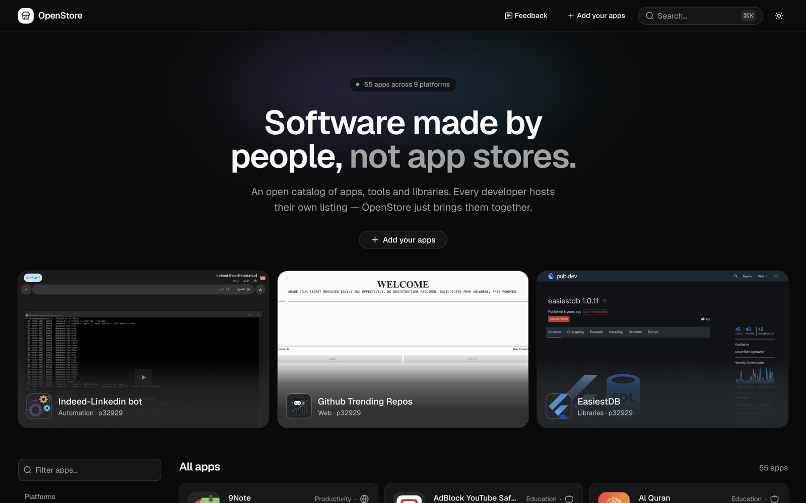
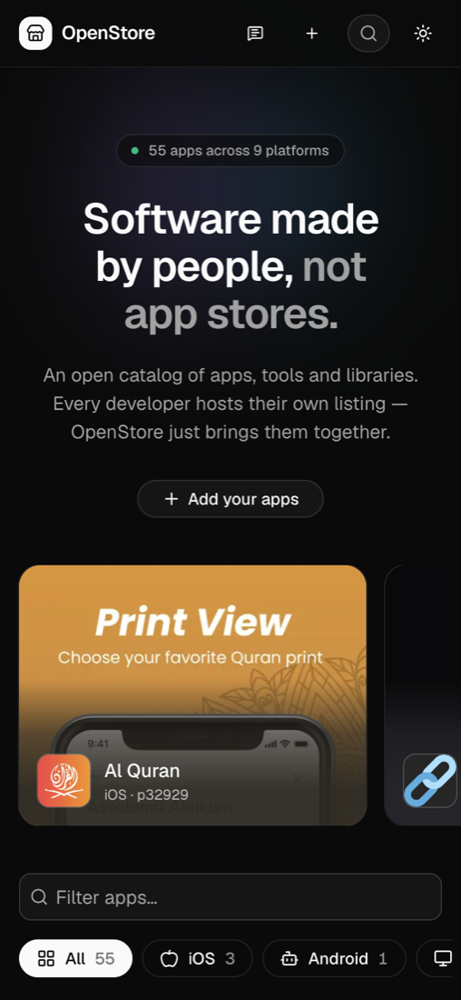

<h1 align="center">OpenStore maintainers</h1>
<p align="center"><b>The list of developers on <a href="https://openstore.pfay.workers.dev">OpenStore</a>.</b><br>
Add one line, open one pull request, and your apps are in the store.</p>
<p align="center"><a href="https://openstore.pfay.workers.dev"><b>See the store →</b></a> &nbsp;·&nbsp; <a href="https://openstore.pfay.workers.dev/add">Step-by-step guide</a> &nbsp;·&nbsp; <a href="https://openstore.pfay.workers.dev/why">Why OpenStore</a></p>

<p align="center">
  <a href="https://openstore.pfay.workers.dev"></a>
  <a href="https://openstore.pfay.workers.dev"></a>
</p>

## What is OpenStore?

An open app store where **you** keep your listing: a few text files in your own public GitHub repo. No fees, no testers, no approval wait, and nobody can remove your apps. Add web apps, Android and iOS apps, desktop apps and libraries, all in one place.

This repo is the list of who is on it: [`maintainers.yaml`](maintainers.yaml), one repo per developer.

## Join in 4 steps

1. **Make your listing repo.** Download or clone the [template](https://github.com/p32929/p32929_openstore/tree/template) into a new **public** repo.
2. **Add your apps.** One `.md` file per app in `apps/`.
3. **Check it.** Run `node validate.mjs`, or paste your repo at [openstore.pfay.workers.dev/validate](https://openstore.pfay.workers.dev/validate).
4. **Open a pull request here** that adds one line at the end of [`maintainers.yaml`](maintainers.yaml):

   ```yaml
   - your-github-name/your-repo
   ```

That is the only time you come here. After this, you just push to your own repo.

## What gets checked

Your pull request is checked automatically:

1. The line is a GitHub repo.
2. Your account is not already listed.
3. Your repo is public and passes every OpenStore check.
4. The pull request comes from the owner of the repo.

If something fails, the check says what. Fix it in your own repo and push; the check runs again.

## Questions?

Ask in [OpenStore feedback](https://github.com/p32929/openstore_feedback): Issues for bugs and ideas, Discussions for everything else.
